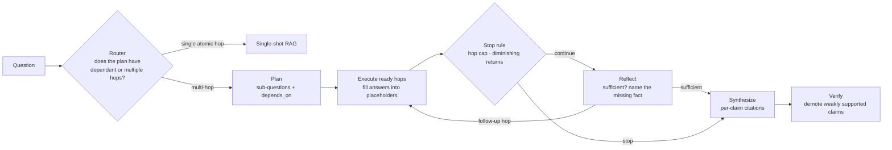

# Agentic RAG for Multi-Hop Research

**A LangGraph research agent that decomposes multi-hop questions into a dependency graph of searches, decides when it has enough evidence, stops itself before it runs away, and answers with per-claim citations — plus a router that skips all of that when a single retrieval pass will do.**

Some questions can't be answered by one retrieval pass, no matter how good the retriever is: "Where is the company that acquired Sparkplug Analytics hosting its EU data?" needs the acquirer's name before the second search can even be phrased. This project builds the iterative agent for those questions, and is equally concerned with when *not* to use it — agentic retrieval costs several model calls per question, so every design choice is about bounding that cost.



## How it works

- **Plans are graphs, not lists.** The planner emits sub-questions that can depend on earlier ones and reference their answers with `{{sq-1}}` placeholders. Every unresolved sub-question whose dependencies are answered forms the next batch, so independent hops can run together and dependent hops wait for the bridge entity.
- **Strong retrieval on purpose.** Dense search in Qdrant and BM25 each return 30 candidates; the union is reranked by `BAAI/bge-reranker-v2-m3` down to 8. With a retriever this strong, a wrong single-shot answer can't be blamed on recall.
- **Reflection that produces work, not a score.** The sufficiency check returns either `sufficient: true` or a single concrete follow-up question that becomes the next hop. Its evidence prompt is deduplicated and capped at 12 passages so a long loop doesn't also mean a runaway token bill.
- **Two bounds on the loop.** A hard cap of 6 hops, and a diminishing-returns gate that stops when the last two hops brought in no unseen passages. Stop reasons (`hop_cap`, `diminishing_returns`, `sufficient`) are recorded so traces explain themselves. Reflection can add work but can never override the budget.
- **Route per query.** The router reuses the planner's output as its classifier: a dependent hop or two or more hops means agentic, otherwise single-shot. An invalid plan falls back to single-shot instead of failing the request, and the plan is passed through so it's never paid for twice.
- **Citations you can check.** Synthesis attaches passage IDs to each claim and has an explicit "could not verify" path. A post-check then demotes any claim sharing less than 30% of its content words with the passages it cites.
- **Serving tuned for agent traffic.** `serving/vllm/launch.sh` runs the model on vLLM with prefix caching and chunked prefill for many short, concurrent calls with repeated prompt prefixes. `research/observability/` traces each hop with per-question cost attribution for Langfuse.

## Running it

Requires Python 3.10+, Docker, and a GPU for the self-hosted model.

```bash
git clone https://github.com/AliAzamat/agentic-rag-deep-research.git
cd agentic-rag-deep-research
pip install langgraph qdrant-client rank_bm25 sentence-transformers openai langfuse

docker compose up -d qdrant vllm langfuse
python -m research.corpus.loader        # embeds data/corpus.jsonl into Qdrant
```

```python
from research.graph.build import research

state = research("Where does the company that acquired Sparkplug Analytics host its EU data?")
print(state["final"]["answer"])
```

The eval and report entry points are `python -m research.eval.run` and `python -m research.report.build`; see [FINDINGS.md](FINDINGS.md) for the full command sequence.

## Layout

| Path | Purpose |
|---|---|
| `research/planning/` | Plan schema, decomposition prompt, placeholder resolution |
| `research/graph/` | LangGraph state, hop execution, sufficiency check, budget, graph wiring |
| `research/retrieval/hybrid.py` | Qdrant + BM25 union with cross-encoder rerank |
| `research/routing/` | Per-query router and threshold calibration |
| `research/synthesis/` | Cited synthesis and lexical-overlap verification |
| `research/baseline/`, `research/demos/` | Single-shot baseline and demos of where it fails |
| `research/eval/` | Eval set loader, grader, runner |
| `research/observability/` | Per-hop tracing and cost roll-up |
| `research/report/build.py` | Comparison report from eval results |
| `serving/` | vLLM launch script and a serving benchmark |
| `docker-compose.yml` | vLLM, Qdrant, Langfuse, Postgres |

## Results

[FINDINGS.md](FINDINGS.md) is a write-up of an evaluation comparing single-shot, agentic, and routed strategies on multi-hop and single-hop questions, including cost, latency, and stop-reason breakdowns, along with guidance on when not to use agentic retrieval.

> The data behind that write-up isn't in this repository: `data/corpus.jsonl` contains 5 sample passages (the write-up describes 4,200), and `data/eval_questions.jsonl` and `results/` aren't committed. The results can't be reproduced from a clone until those are added.
